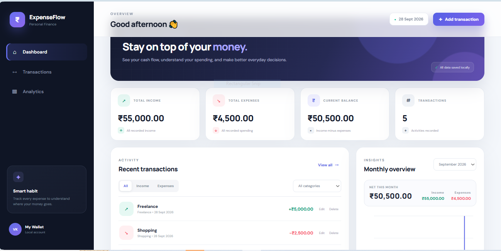

# ExpenseFlow — Personal Finance Dashboard

A modern, responsive Expense Tracker web application built using **HTML, CSS, and vanilla JavaScript**.

This project was developed as part of the **Software Developer Intern recruitment task**.
## 📸 Dashboard Preview



---

## ✨ Features

### 💰 Transaction Management

- Add income transactions
- Add expense transactions
- Enter:
  - Amount
  - Category
  - Date
  - Description
- Edit existing transactions
- Delete transactions
- Confirmation before deleting transactions

### 📊 Financial Dashboard

The dashboard provides an overview of:

- Total Income
- Total Expenses
- Current Balance
- Total Number of Transactions

### 🔎 Transaction Filtering

Transactions can be filtered by:

- All transactions
- Income
- Expenses
- Category

### 📈 Analytics

The application includes:

- Monthly income summary
- Monthly expense summary
- Monthly net balance
- Monthly cash-flow visualization
- Category-wise expense breakdown
- Expense donut chart

### 💾 Local Storage

Transaction data is stored using the browser's **Local Storage API**.

This means transactions remain available even after refreshing or reopening the application in the same browser.

### 📱 Responsive Design

The interface is designed to work across:

- Desktop
- Laptop
- Tablet
- Mobile devices

### ✅ Validation & UX

The application includes:

- Amount validation
- Category validation
- Date validation
- Helpful error messages
- Empty states
- Success notifications
- Delete confirmation
- Responsive navigation
- Smooth UI interactions

---

## 🛠️ Tech Stack

| Technology | Purpose |
|------------|---------|
| HTML5 | Application structure |
| CSS3 | Styling and responsive UI |
| JavaScript ES6+ | Application logic and DOM manipulation |
| Local Storage API | Persistent transaction storage |
| Canvas API | Charts and data visualization |

No frontend framework or backend is required.

---

## 📂 Project Structure

```text
expense-tracker-vinayak-k-satheesh/
│
├── index.html       # Main application page
├── style.css        # Application styling and responsive design
├── script.js        # Application logic and functionality
└── README.md        # Project documentation
